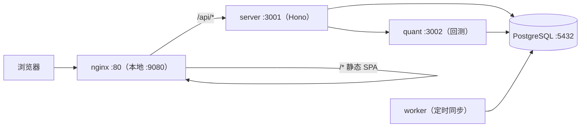
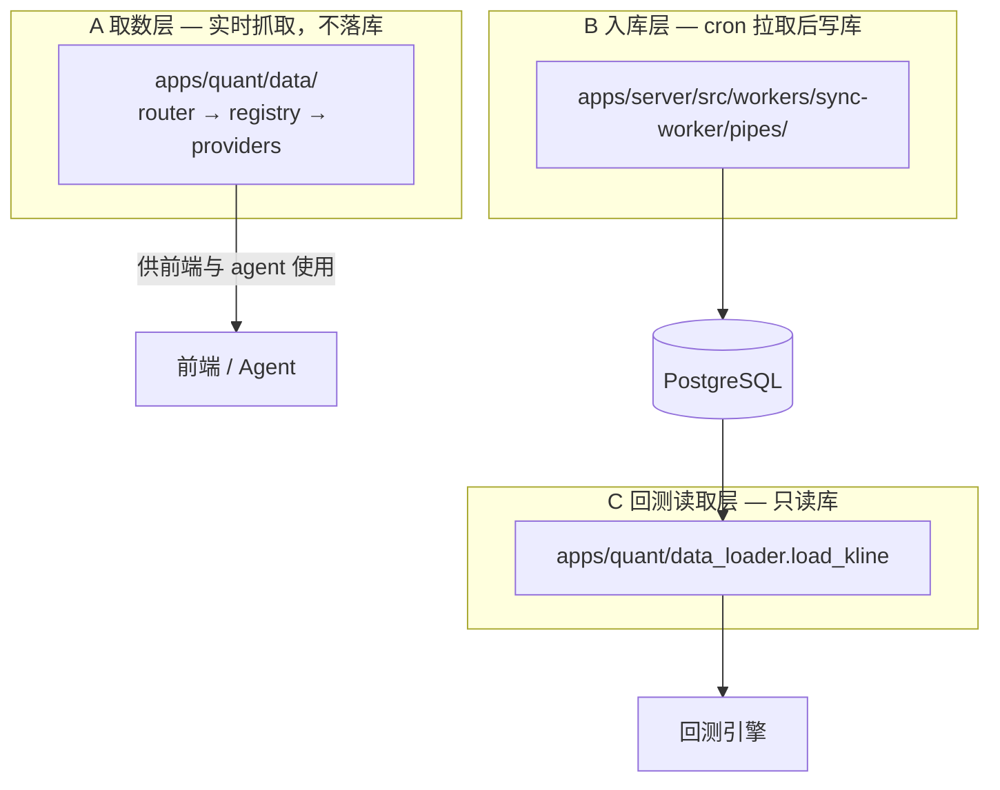
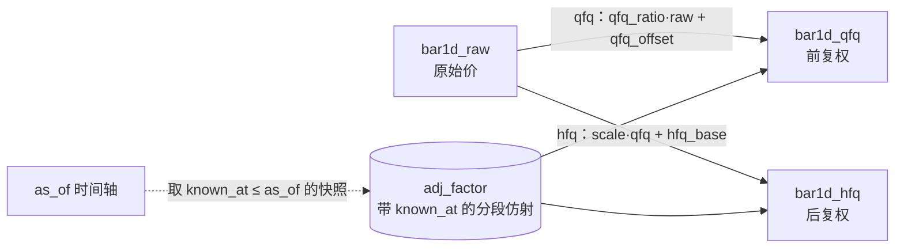

# ai-trader 知识库

> 智能 A 股分析与策略平台。**本目录是项目知识的唯一事实源**；[AGENTS.md](../AGENTS.md) 只保留「AI 常驻硬约束速查 + 本库导航」。

## 0. 这是什么

pnpm monorepo，四个模块 + 一个数据库 + 一套日志栈，Docker Compose 全容器部署。

| 模块 | 路径 | 技术 | 本地端口 |
|---|---|---|---|
| 前端 | `apps/web` | React 19 + Vite + TanStack Router + Preline + Tailwind CSS | 9080（容器内 80，nginx） |
| API | `apps/server` | Hono + Drizzle | 3001 |
| 数据同步 Worker | `apps/server/src/workers` | 定时任务（cron） | — |
| 回测 | `apps/quant` | Python FastAPI + akquant | 3002 |
| 数据库 | — | PostgreSQL + pgvector | 5432 |
| 日志栈 | `docker/` | Alloy → Loki → Grafana | Loki 3100 / Alloy 12345 / Grafana 3010 |

## 1. 三分钟全局图

### 1.1 系统拓扑

### 1.2 数据三链路（最容易踩坑的地方）

**取数层与回测读取层是两条独立链路**，改动数据源前必须先分清要改哪一层。

| 链路 | 位置 | 性质 |
|---|---|---|
| A 取数层 | `apps/quant/data/`（router → registry → providers） | 实时抓取，不落库，供前端与 agent 使用 |
| B 入库层 | `apps/server/src/workers/sync-worker/pipes/` | cron 拉取后写入 PostgreSQL |
| C 回测读取层 | `apps/quant/data_loader.load_kline` | 只查库内复权视图/表函数 |

完整链路：`sync-worker` → quant `/api/v1/data/kline` → PostgreSQL → `load_kline` → 回测引擎。

详见 [data-pipeline.md](./data-pipeline.md)。

### 1.3 复权与 PIT 模型

- **PIT（Point-In-Time）**：`adj_factor` 是 append-only，带 `known_at`。指定 `as_of` 时只用该时刻之前已知的复权快照，消除前视偏差。
- 不指定 `as_of` → 取最新快照（默认行为，零回归）。

详见 [invariants.md](./invariants.md)。

## 2. 导航

| 文档 | 讲什么 | 什么时候看 |
|---|---|---|
| [architecture.md](./architecture.md) | 模块、端口、容器拓扑、部署 | 想搞懂系统长什么样 |
| [data-pipeline.md](./data-pipeline.md) | A/B/C 三条数据链、切源的两条路径 | 要改数据源 / 排查数据问题 |
| [invariants.md](./invariants.md) | 铁律清单 INV-1..N（不可违背） | 动手改任何核心代码前 |
| [runbooks.md](./runbooks.md) | 排障手册：僵尸任务 / 东财熔断 / 回测超时 | 线上出问题时 |
| [decisions.md](./decisions.md) | 决策记录（已决·勿翻案） | 想重复论证某个结论前 |
| [issues.md](./issues.md) | 已知缺陷 & 技术债 | 遇到怪现象时先查这里 |
| [glossary.md](./glossary.md) | 术语表 | 看不懂某个词时 |
| [roadmap.md](./roadmap.md) | 路线图（已完成 / 进行中 / 待办） | 想知道下一步做什么 |

## 3. 建议阅读路径

- **第一次接触项目** → 「1. 三分钟全局图」→ architecture.md → data-pipeline.md。
- **要改代码** → invariants.md（先看约束）→ corresponding 主题文档 → runbooks.md（避坑）。
- **排障** → runbooks.md → issues.md → decisions.md。
- **接手规划** → roadmap.md → issues.md。
