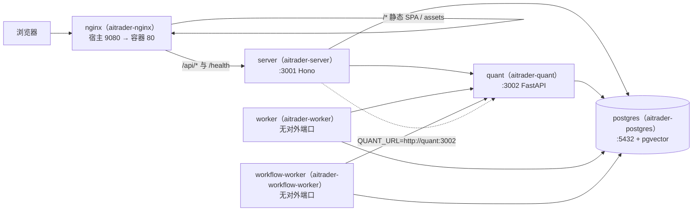
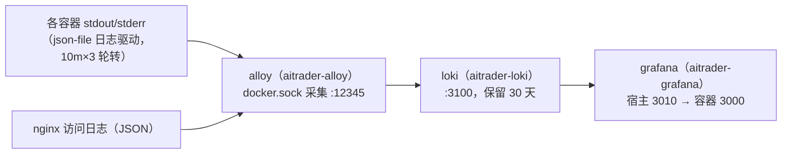

# 架构（architecture）

> 智能 A 股分析与策略平台 ai-trader 的模块划分、端口、容器拓扑与部署方式。
> 每节采用统一骨架：**定义 / 位置 / 关键事实 / 来源**。内容全部取自仓库既有事实，不含推测。
> 返回导航：[docs/README.md](./README.md)。

## 1. 模块总览

- **定义**：pnpm monorepo，四个应用模块 + 一个数据库 + 一套日志栈，Docker Compose 全容器部署。
- **位置**：`apps/web`、`apps/server`、`apps/quant`、`packages/lint`；基础设施在 `docker/`、`deploy/`。
- **关键事实**：

| 模块 | 路径 | 技术 | 本地端口 |
|---|---|---|---|
| 前端 | `apps/web` | React + Vite；nginx 代理 | 9080（容器内 80） |
| API | `apps/server` | Hono；含 sync / feature / workflow worker | 3001 |
| 回测 | `apps/quant` | Python FastAPI + akquant | 3002 |
| 数据库 | — | PostgreSQL + pgvector | 5432 |
| 日志栈 | `docker/` | Grafana Alloy → Loki → Grafana | Loki 3100 / Alloy 12345 / Grafana 3010 |

- **来源**：AGENTS.md「项目架构」、README.md「架构」、docs/README.md「0. 这是什么」。

## 2. 容器拓扑

- **定义**：`docker-compose.yml` 定义 10 个服务（nginx / server / worker / workflow-worker / research-worker / quant / postgres / loki / alloy / grafana）。
- **位置**：`/docker-compose.yml`；各服务镜像由 `docker/web.Dockerfile`、`docker/server.Dockerfile`、`docker/quant.Dockerfile`、`docker/postgres.Dockerfile` 构建。
- **关键事实**：

- 服务依赖：`nginx → server → postgres`；`worker → postgres`；`workflow-worker → postgres + quant`；`quant → postgres`。
- `server` 的 `QUANT_URL=http://quant:3002`，`worker` 与 `workflow-worker` 同样经容器服务名访问 quant。
- **来源**：`docker-compose.yml`、README.md「架构」。

## 3. 端口与容器清单

- **定义**：各服务的宿主↔容器端口映射、容器名与依赖关系。
- **位置**：`/docker-compose.yml`（生产）；`/docker-compose.dev.yml`（仅 PostgreSQL，容器名 `aitrader-postgres-dev`）。
- **关键事实**：

| 服务 | 容器名 | 端口（宿主:容器） | 依赖 | 备注 |
|---|---|---|---|---|
| nginx | `aitrader-nginx` | `9080:80` | server | 前端静态 + /api 反代 |
| server | `aitrader-server` | `3001:3001` | postgres | Hono API |
| worker | `aitrader-worker` | 无 | postgres | `command: pnpm --prefix apps/server worker:sync` |
| workflow-worker | `aitrader-workflow-worker` | 无 | postgres / quant | `command: pnpm --prefix apps/server worker:workflow` |
| research-worker | `aitrader-research-worker` | 无 | postgres / quant | `command: pnpm --prefix apps/server worker:research`；研报全文索引并发 1 |
| quant | `aitrader-quant` | `3002:3002` | postgres | FastAPI + akquant |
| postgres | `aitrader-postgres` | `5432:5432` | — | 卷 `pgdata` |
| loki | `aitrader-loki` | `3100:3100` | — | `grafana/loki:3.3.2` |
| alloy | `aitrader-alloy` | `12345:12345` | loki | `grafana/alloy:v1.5.1` |
| grafana | `aitrader-grafana` | `3010:3000` | loki | `grafana/grafana:11.4.0` |

- 启动后访问入口（README）：`http://localhost`（前端）、`http://localhost/signup`（注册）、`http://localhost/health`（API 健康检查）、`http://localhost:3002/docs`（quant API 文档）。
- **来源**：`docker-compose.yml`、`docker-compose.dev.yml`、README.md「访问」「按模块单独启动」。

## 4. 反向代理与超时（nginx）

- **定义**：nginx 承担 SPA 静态托管与 `/api`、`/health` 反向代理，并生成全链路 request_id。
- **位置**：`/docker/nginx.conf`（`conf.d/`，被 include 在 `http{}` 内）。
- **关键事实**：
  - `location /api/` → `proxy_pass http://server:3001`；`location /health` → `server:3001`。
  - `proxy_set_header X-Request-Id $request_id`，使「nginx 访问日志 ↔ server 业务日志」可用同一 request_id 关联。
  - SSE 支持：`proxy_buffering off; proxy_cache off;`（AI Chat 流式响应）。
  - 长耗时接口（选股等 quant 全市场打分 40–60s）：当前配置 `proxy_read_timeout 300s` / `proxy_send_timeout 300s`；配置注释记载原 `120s` 会在上游仍在计算时先断开并返回 504 HTML，导致前端解析 JSON 失败。
  - 静态资源策略：`/index.html` 不缓存；`/assets/`（带 content hash）`Cache-Control: public, max-age=31536000, immutable`；其余走 SPA fallback `try_files $uri $uri/ /index.html`。
  - 访问日志为统一 JSON 格式（`escape=json`），`level` 按 HTTP 状态码映射（5xx→error、4xx→warn、其余 info），供 Alloy 解析写入 Loki。
- **来源**：`docker/nginx.conf`；AGENTS.md「回测服务」已知缺陷（记载原 120s 超时会返回 HTML 504 致前端解析失败）。

## 5. 部署方式

- **定义**：三种部署/运行方式——一键全容器、按模块单独启动、本地非 Docker 开发。
- **位置**：`deploy/`（`setup.sh`、`start.sh`、`stop.sh`、`start-*.sh`、`_common.sh`、`remote-deploy.sh`）。
- **关键事实**：
  - **一键部署**：`chmod +x deploy/*.sh && ./deploy/setup.sh`；脚本检查 docker → 从 `apps/server/.env.example` 生成 `.env.local` → `docker compose build/up -d` → 等 `pg_isready -U ai-trader` → 执行 `db:migrate` → `sync:instruments`。
  - **按模块单独启动**：每个模块有独立脚本，`start-*.sh` 支持 `--build`、`-f/--follow`、`--no-deps`、`-h/--help`；`./deploy/stop.sh db` 可停止单个模块（db/server/worker/quant/web）。

    | 脚本 | 模块 | 容器名 | 端口 | 依赖 |
    |---|---|---|---|---|
    | `./deploy/start-db.sh` | 数据库 | `aitrader-postgres` | 5432 | — |
    | `./deploy/start-server.sh` | API 服务 | `aitrader-server` | 3001 | postgres |
    | `./deploy/start-worker.sh` | 数据同步 Worker | `aitrader-worker` | — | postgres |
    | `./deploy/start-workflow-worker.sh` | 工作流 Worker | `aitrader-workflow-worker` | — | postgres / quant |
    | `./deploy/start-quant.sh` | 回测微服务 | `aitrader-quant` | 3002 | postgres |
    | `./deploy/start-web.sh` | 前端（nginx） | `aitrader-nginx` | 9080 | server |

  - **本地开发（非 Docker）**：`pnpm install` → `docker compose up -d postgres`（仅启动数据库）→ `pnpm db:migrate` → `pnpm dev`（turbo dev + quant:dev）。开发数据库用 `docker-compose.dev.yml`，不可与生产 `docker-compose.yml` 同时运行。
  - **环境变量**：`DATABASE_URL`、`BETTER_AUTH_SECRET`、`BETTER_AUTH_URL`、`DEEPSEEK_API_KEY` 为必填；`QUANT_URL` 选填（Docker 自动覆盖）。写入 `.env.local`。
- **来源**：README.md「部署到新机器」「按模块单独启动」「环境变量」「本地开发」、`deploy/setup.sh`、`deploy/start-web.sh`、`docker-compose.dev.yml`。

## 6. 日志与可观测性拓扑

- **定义**：采集栈 Grafana Alloy → Loki → Grafana，统一收集各容器日志与 nginx 访问日志。
- **位置**：`docker/alloy/config.alloy`、`docker/loki/loki-config.yml`、`docker/grafana/provisioning/`。
- **关键事实**：

  - 日志用 pino：生产 JSON、开发 pino-pretty；`level` 在产出端就归一为字符串（采集侧当 Loki label，数字会变成无意义取值）。
  - 全链路追踪用 AsyncLocalStorage：HTTP 入口由 `middleware/request-id.ts` 建上下文（`source=external`），定时任务由 `wrapJob` 建（`source=scheduled|manual`）；`lib/quant.ts` 把上下文作为 `X-Request-Id` / `X-Job-Run-Id` 等请求头透传到 quant。
  - `request_id` / `job_run_id` 等高基数字段进 Loki **structured metadata**，不做 label（防索引爆炸）。
- **来源**：AGENTS.md「日志与可观测性」、`docker-compose.yml`、docs/README.md「0. 这是什么」。
