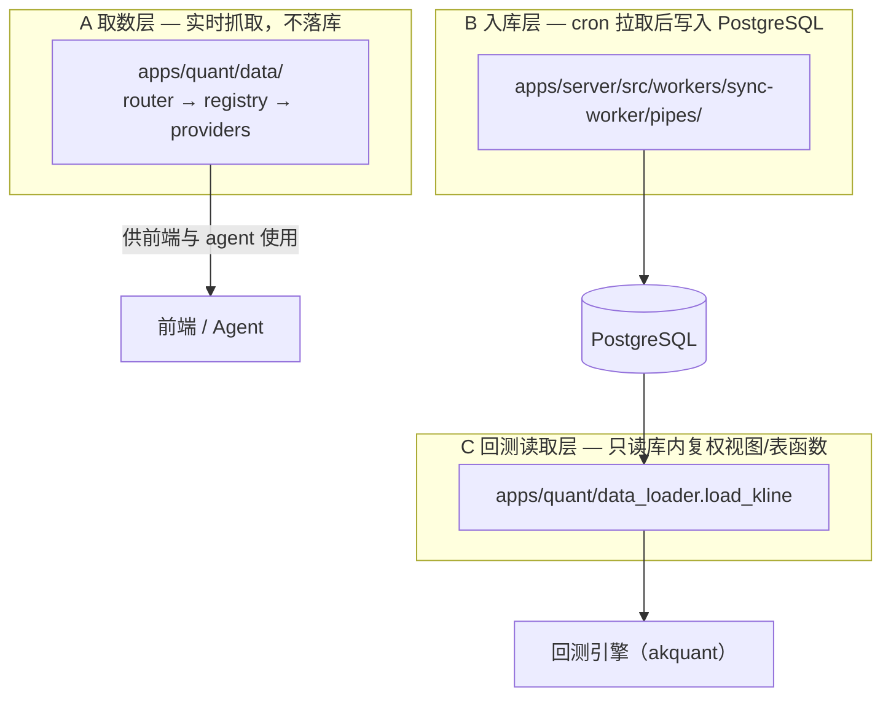
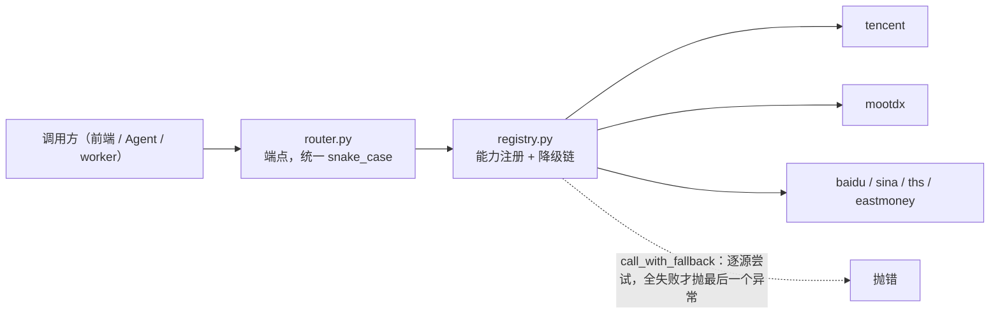
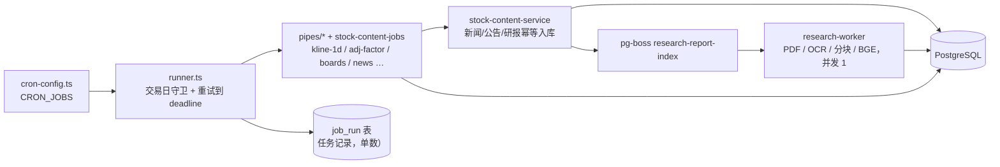
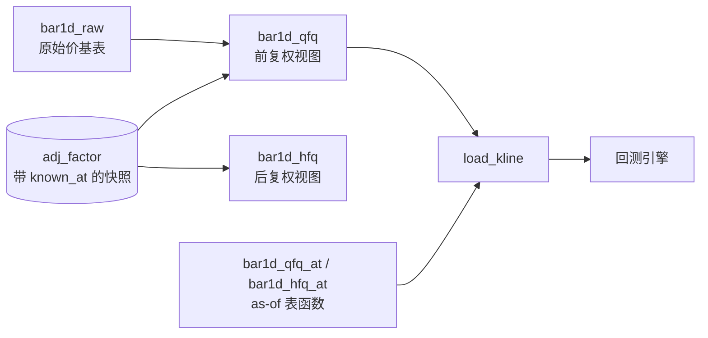
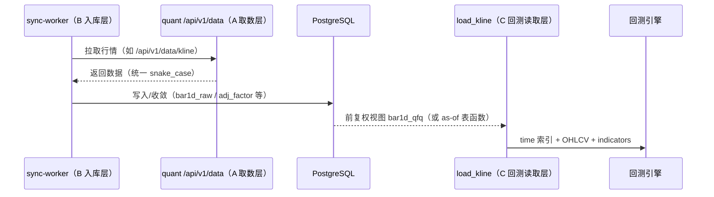

# 数据链路（data-pipeline）

> ai-trader 的取数、入库、回测读取三条链路，切换数据源的两条路径，以及数据源清单。
> 每节采用统一骨架：**定义 / 位置 / 关键事实 / 来源**。内容全部取自仓库既有事实，不含推测。
> 返回导航：[docs/README.md](./README.md)。

## 1. 三条链路总览

- **定义**：取数层与回测读取层是**两条独立链路**，改动数据源前必须先分清要改哪一层。
- **位置**：A 取数层 `apps/quant/data/`；B 入库层 `apps/server/src/workers/sync-worker/pipes/`；C 回测读取层 `apps/quant/data_loader.load_kline`。
- **关键事实**：

| 链路 | 位置 | 性质 |
|---|---|---|
| A 取数层 | `apps/quant/data/`（router → registry → providers） | 实时抓取，不落库，供前端与 agent 使用 |
| B 入库层 | `apps/server/src/workers/sync-worker/pipes/` | cron 拉取后写入 PostgreSQL |
| C 回测读取层 | `apps/quant/data_loader.load_kline` | 只查库内复权视图/表函数（前复权视图 `bar1d_qfq`） |

- 完整链路：`sync-worker` → quant `/api/v1/data/kline` → PostgreSQL → `load_kline` → 回测引擎。
- **来源**：AGENTS.md「数据链路」、docs/README.md「1.2 数据三链路」。

## 2. A 取数层（实时抓取，不落库）

- **定义**：统一数据获取服务（FastAPI），挂载于 `/api/v1/data`，返回字段统一 snake_case，供前端与 agent 使用。
- **位置**：`apps/quant/data/`（`router.py` → `registry.py` → `providers/<name>/provider.py`），协议定义在 `data/base.py` 的 `MarketProvider`。
- **关键事实**：

  - 架构：`router`（端点）→ `registry`（能力注册 + 降级链）→ `providers`（各数据源实现）；调用方只面向 `MarketProvider` 协议编程，切换/增删数据源无需改上层。
  - 除 `/sources` 外，每个端点都带可选 `source` 参数：指定则强制用该源（不支持该能力返回 400），不指定走降级链。
  - 验证入口：`GET /api/v1/data/sources` 与 `GET /api/v1/data/kline?symbol=...&source=<name>`。
  - 能力常量见 `data/base.py`（`CAPABILITY_KLINE` / `CAPABILITY_QUOTE` / `CAPABILITY_TRANSACTION` / `CAPABILITY_ADJUST_FACTOR` 及信号/资金/筹码层各项）。
  - K 线端点 `/kline` 参数：`symbol`（必填）、`tf`（1m/5m/15m/30m/60m/1d/1w/1mo）、`adjust`（qfq/hfq/none，仅 tf=1d 有效）、`start`/`end`、`limit`（1~5000）、`source`。
- **来源**：AGENTS.md「数据链路」「切换数据源的两条路径」、`apps/quant/data/README.md`「端点手册」`/sources` `/kline`、`apps/quant/data/registry.py`、`apps/quant/data/router.py`。

## 3. B 入库层（cron 拉取后写库）

- **定义**：定时任务（cron）拉取数据后写入 PostgreSQL 的管道。
- **位置**：`apps/server/src/workers/sync-worker/pipes/`（管道）+ `apps/server/src/workers/sync-worker/cron-config.ts`（调度）+ `apps/server/src/workers/sync-worker/runner.ts`（执行/清理）。
- **关键事实**：

  - 交易日收盘后统一 `10 15 * * 1-5` 触发（腾讯日线收盘后即定稿），管道内部循环重试到 `deadline`（18:00），`hasSuccessToday` 保证每天只成功一次。
  - 依赖关系（下游内部等待上游成功）：`boards → board-kline / constituents`；`kline-1d → adj-factor → kline-period / features`（`adj-factor` 反解腾讯仿射复权参数，是 qfq/hfq 视图的数据来源，须先于读视图的下游）。
  - 历史回补为独立任务：`limit-up-pool-backfill`（19:00）、`dragon-tiger-backfill`（19:05）、`hot-reason-backfill`（19:10）、`kline-1d-backfill`（19:30），deadline 22:00；显式排除当日，`kline-1d-backfill` 完成后内联重收敛 `adj-factor` 与 `kline-period`。
  - 其他计划：`news`（`*/2 * * * *`，仅交易日 07:00–23:00）、`stock-announcements`（`5 18 * * 1-5`）、`stock-research-reports`（`10 18 * * 1-5`）、`stock-fundamentals`（`20 18 * * 1-5`）、`calendar`（`0 2 * * 1`）、`partition-maint`（`20 2 * * 1`，巡检 `bar1d_raw` 年度分区）；`kline-1m` / `gap-detect` 为未实现空壳，`enabled: false`。
  - 跨资产行情使用独立 `market_asset_*` 表：`market-asset-minute` 每分钟刷新固定资产报价/分钟线，`market-asset-daily` 每日 06:10 与 16:10 刷新日线，`market-asset-daily-backfill` 每周回填日线；三者由 `MARKET_ASSET_INGEST_ENABLED=true` 启用。`market-asset-retention` 每日只删除超过 13 个月的分钟线，不触碰日线、报价或 A 股复权/回测表。
  - 跨资产时序按资产固定来源：A 股指数与 ETF 走腾讯，XAU 走新浪，IXIC 走 Yahoo；registry 按资产过滤 provider，避免把“明确不支持该资产”的备源当成有效降级。腾讯日线单次请求上限取 600 根；`1D` 读库从最近 7 个自然日回看并只保留最新完整 session，周末与跨时区不会退化成空图。
  - 自选股内容只遍历 `watchlist`，新闻回填 20 条、公告回填 30 天、研报首次回填 12 个月；后续研报元数据按 `sync_cursor` 只请求最近 7 天并保留 7 天重叠。`stock-fundamentals` 同步一致预期、mootdx 财务快照、新浪财务三表和 Baostock 估值；单股失败继续下一只，结束后汇总抛出使 `job_run` 反映部分失败。
  - `news` 与任意个股“重新分析”都调用 `stock-content-service`：新闻始终关联查询标的，公告按 `(source, source_url)`、研报按 `(source, source_id)`、一致预期/财务/估值按各自业务主键幂等写入；单模块失败不清空其他模块。北交所没有 Baostock 估值，自选股基本面任务只跳过该模块。
  - 研报元数据同步不等于全文入库。元数据落库后，分析页通过独立 `POST /research-reports/index-window` 入队；自选股研报任务完成后也自动排队最近 30 天全文，并使用较低优先级。独立 `research-worker` 全局并发 1，串行执行 PDF 下载、文本/OCR、分块和本地 BGE 向量化；当前分析优先级高于自选股后台批次。`pending` 超过 10 分钟会由 worker 启动或周期巡检重新入队；新闻不生成向量。两类内容的检索边界见 [RAG 标准](./standards/rag.md)。
  - `research-report-index` 中单篇任务使用提取器、分块版本和 embedding 模型组成 singleton key；失败最多重试 3 次并指数退避，页面 GET 不执行 OCR 或入库。
  - 首批真实验证以 `002594.SZ` 和 `600519.SH` 完成 18 篇、75 页、48 个分块和 48 个向量；Golden Set 与已知召回差距见 [RAG 验证报告](../openspec/changes/archive/2026-11-20-complete-research-rag-pipeline/verification.md)。
  - 任务记录表名是 `job_run`（**单数**，`apps/server/src/db/schema/ops.ts`）；手工查询写成 `job_runs` 会报 `relation does not exist`。
  - kline-1d 全市场（约 5552 只，源固定腾讯）正常约 46 分钟跑完。
- **来源**：AGENTS.md「数据链路」「定时任务与任务记录（job_run）」、`apps/server/src/workers/sync-worker/cron-config.ts`。

## 4. C 回测读取层（只读库）

- **定义**：回测引擎唯一的数据入口，只读 PostgreSQL 内由原始价基表与复权因子派生的复权视图/表函数。
- **位置**：`apps/quant/data_loader.py`（`load_kline`、`load_raw_close` 等）。
- **关键事实**：

  - `load_kline(symbol, start, end, adjust, as_of)`：`adjust` 取 `hfq`/`qfq` 分别映射视图 `bar1d_hfq`/`bar1d_qfq`；传 `as_of` 时改走同名 as-of 表函数 `bar1d_hfq_at`/`bar1d_qfq_at`，按 `known_at <= as_of` 选取「站在该历史时刻」的复权因子快照，`None` 时读视图（取每个 symbol 最新 `known_at` 快照），保持既有行为。
  - `load_kline` 的输出契约（`time` 索引 + `open/high/low/close/volume/amount/indicators`）**不可更改**，否则回测、选股、指标三处会同时失效。
- **来源**：AGENTS.md「数据链路」「A 股回测可信度缺口」、`apps/quant/data_loader.py`（`_ADJUST_VIEWS` / `_ADJUST_AT_FUNCS` / `load_kline`）。

## 5. 完整链路（端到端）

- **定义**：从抓取到回测的端到端流转。
- **位置**：跨 `apps/server`、`apps/quant`、PostgreSQL。
- **关键事实**：

- **来源**：AGENTS.md「数据链路」、docs/README.md「1.2 数据三链路」。

## 6. 切换数据源的两条路径

- **定义**：改数据源必须先确定改哪一层，两条路径的改动面与风险不同。
- **位置**：A 路径 `apps/quant/data/registry.py`；B/C 路径 `apps/server/src/workers/sync-worker/pipes/kline-1d.ts` 与 `apps/quant/data_loader.py`。
- **关键事实**：
  - **切取数层（A）**：只需改两处——`data/registry.py` 的 `_PROVIDER_CLASSES`（注册 provider 类）与 `_CAPABILITY_PRIORITY`（决定降级链顺序）。新 provider 放 `data/providers/<name>/provider.py`，实现 `data/base.py` 的 `MarketProvider` 协议。验证用 `GET /api/v1/data/sources` 与 `GET /api/v1/data/kline?symbol=...&source=<name>`。
  - **切回测数据源（B/C）**：必须改入库管道（`pipes/kline-1d.ts` 的选源逻辑）、重建历史数据，并做新旧源双跑比对后再上生产。
  - `kline-1d.ts` 按标的**固定单一源**（`klineSource(symbol)`：`.BJ` → 东财 push2his，其余 → 腾讯）而非启用降级，正是为防止上游限流下静默切换污染**原始价**口径（本管道落库 `adjust=none` 原始价，复权由 `adj-factor` 管道反解因子后经 `bar1d_qfq` / `bar1d_hfq` 视图派生；同一条降级链内不得混用不同复权口径）。
- **来源**：AGENTS.md「切换数据源的两条路径」「数据源铁律」。

## 7. 数据源清单与降级链

- **定义**：A 取数层已登记的数据源及其能力/风控特征，以及各能力的降级链顺序。
- **位置**：`apps/quant/data/registry.py`（`_PROVIDER_CLASSES` / `_CAPABILITY_PRIORITY`）、`apps/quant/data/README.md`（数据源总览）。
- **关键事实**：
  - **8 个 Provider 总览**（来源 `apps/quant/data/README.md`）：

    | Provider | 能力（capabilities） | 接口域名 | 风控特征 |
    |---|---|---|---|
    | `tencent` 腾讯 | quote、kline、transaction | `qt.gtimg.cn`、`proxy.finance.qq.com`、`stock.gtimg.cn` | 不封 IP，连续 5000+ 次才限流返回空 |
    | `mootdx` 通达信 | kline、quote、transaction、financial_snapshot | 本地 TDX 行情库（非 HTTP） | 本地接口，无网络风控 |
    | `baidu` 百度 | kline | `finance.pae.baidu.com` | 需 Origin/Referer，低频不封 |
    | `sina` 新浪 | adjust_factor、stock_news、financial_statements | `finance.sina.com.cn`、`quotes.sina.cn` | 带 UA/Referer，低频不封 |
    | `ths` 同花顺 | hot_reason、northbound、analyst_consensus | `zx.10jqka.com.cn`、`data.hexin.cn`、`basic.10jqka.com.cn` | 需 UA/Referer，低频不封 |
    | `eastmoney` 东财 | 信号/资金/筹码/内容层多项 + 一致预期备源 | `push2` / `push2delay` / `push2his` / `datacenter-web` / `search-api-web` / `reportapi` | 有风控：>5次/秒、并发≥10、1分钟≥200 会临时封 IP，统一走 `_em_get` 串行限流 |
    | `cninfo` 巨潮 | announcement | `www.cninfo.com.cn` | 带 UA/Referer，公告主源 |
    | `baostock` | valuation_history | Baostock TCP 客户端 | 免注册；**不支持北交所** |

  - **降级链（`registry._CAPABILITY_PRIORITY`，源名有序、主源在前）**：

    | 能力 | 降级链 |
    |---|---|
    | `kline` | tencent → mootdx → baidu |
    | `quote` | tencent → mootdx |
    | `transaction` | tencent → mootdx |
    | `adjust_factor` | sina |
    | `hot_reason` / `northbound` | ths |
    | `concept_blocks` / `fund_flow_minute` / `dragon_tiger` / `lockup_expiry` / `industry_comparison` / `board_fund_flow` / `daily_dragon_tiger` / `board_list` / `board_constituents` / `board_kline` / `fund_flow_rank` / `limit_up_pool` | eastmoney |
    | `margin_trading` / `block_trade` / `holder_num` / `dividend_history` / `fund_flow_120d` / `chip_distribution` | eastmoney |
    | `stock_news` | eastmoney → sina |
    | `market_news` | eastmoney |
    | `announcement` | cninfo → eastmoney |
    | `analyst_consensus` | ths → eastmoney |
    | `financial_snapshot` | mootdx |
    | `financial_statements` | sina |
    | `valuation_history` | baostock |

  - 补充：`eastmoney` 也声明了 `kline` 能力，但**不在** `kline` 降级链内——仅当显式传 `source=eastmoney` 时使用（供北交所经 `push2his` 的 `fqt=0/1/2` 三口径取原始价 / 复权参数，见 `pipes/kline-1d.ts`、`pipes/adj-factor.ts`）。
  - 降级机制：行情、内容与基本面按 `_CAPABILITY_PRIORITY` 顺序调用，任一源失败落到下一源，全部失败才抛最后一个异常；`stock_news`、`announcement` 和 `analyst_consensus` 为真实多源链路，`adjust_factor`、`market_news`、财务快照、财务三表和估值历史为单源。
  - 独有单源：信号/资金/筹码层多为东财或同花顺「独有、别处拿不到」，财务快照、财务三表和估值历史也各固定一个来源；真正兜底在 server 端——sync 脚本对每类数据 `try/catch` 失败即 `skip` 不中断整轮；热力图等实时页面在 DB 兜底模式跳过成分股、15s 总时限。
- **来源**：AGENTS.md「数据源铁律」、`apps/quant/data/registry.py`、`apps/quant/data/README.md`「数据源总览」「降级机制」。

## 8. 数据源铁律

- **定义**：抓数时必须遵守的硬性约束。
- **位置**：`apps/quant/data/`（`eastmoney` provider 的 `_em_get`、`common.py`）；`apps/server/src/workers/sync-worker/pipes/kline-1d.ts`。
- **关键事实**：
  - 优先级：mootdx（TCP，不封 IP）> 腾讯（HTTP GBK，不封 IP）> 新浪 / 巨潮 / 同花顺 > 东财（有风控会封 IP，仅用于其独有数据）。
  - 东财必须走统一的 `em_get()` 串行限流，禁止直接 `requests.get`。
  - `em_get` 防雪崩加固：串行锁只覆盖「等待最小间隔 + 发起单次请求」，重试退避睡眠放在锁外；连续失败达阈值（5）即熔断跳闸，冷却 `300s`（5 分钟，`_EM_BREAKER_COOLDOWN = 300.0`）内东财请求快速失败上抛，交给上层降级链；`_em_get_kline` 遇熔断直接上抛，不再做 `/..` 二次重试。（注：AGENTS.md 载「冷却 30s」为过时值，以代码为准。）
  - 行情类端点统一走 `push2delay`（延迟行情），不用实时 `push2`——后者并发下易 `RemoteDisconnected`；`push2his` 用于历史 K 线/日线资金流。
  - 东财个股新闻（`search-api-web.eastmoney.com/search/jsonp`）必须用 `type:["cmsArticleWebOld"]` + `param.cmsArticleWebOld` 子对象；响应是 JSONP，取首个 `(` 与末个 `)` 之间再解析，列表在 `result.cmsArticleWebOld`。该请求只允许存在于 quant Provider，server 新闻管道不得直连。
  - 东财全市场快讯当前字段为 `showTime`、`code`、`stockList`；Provider 必须补全详情 URL、发布时间和关联标的，禁止把空 URL 直接入库。
  - 公告主源巨潮使用动态 `orgId` 和 POST 表单；备源东财使用 `np-anotice-stock.eastmoney.com`。两者统一在 quant 内容端点返回。
  - **同一条降级链内不得混用不同复权口径**。
- **来源**：AGENTS.md「数据源铁律」、`apps/quant/data/README.md`「风控方案」。

## 9. 回测可信度缺口（回测或换源前必查）

- **定义**：影响回测可信度的已知缺口。
- **位置**：`apps/quant/data_loader.py`（`as_of`）、`apps/quant/main.py`（`BacktestRequest.asOf`）。
- **关键事实**：
  - **复权 PIT 化**：回测链已接 PIT——`BacktestRequest.asOf` → `load_kline(..., as_of=)` → `bar1d_*_at` 表函数按 `known_at <= asOf` 取历史复权快照；但 `adj_factor` 目前仅 1 个快照 `2026-10-01`，早于该时刻无版本可选、等价于不复权，需每日 adj-factor 同步累积出多版本后才有区分度。
  - 其他缺口：停牌标记、涨跌停成交判定。
  - 另注意 baostock 不支持北交所。
- **来源**：AGENTS.md「A 股回测可信度缺口（回测或换源前必查）」、`apps/quant/data_loader.py`、`apps/quant/main.py`。

## 10. 数据管理入口（超级管理员）

- **定义**：数据工程观察与受控操作统一收口到工作台内的 `/home/data-management`。
- **位置**：页面 `apps/web/src/routes/home/data-management/`；API `apps/server/src/api/data-management.ts`；权限 `apps/server/src/lib/admin-access.ts`；审计 `apps/server/src/lib/admin-audit.ts`。
- **关键事实**：
  - `user` 只能看到主题设置；`super_admin` 看到“数据管理”和“主题设置”。角色由数据库 `user.role` 决定，`SUPER_ADMIN_EMAILS` 只对已通过邮箱验证的会话执行首次超级管理员引导；邮箱移出白名单不会静默降级已有数据库角色。
  - `/api/v1/data-management/*` 全部经过服务端 `super_admin` 校验；无会话返回 401，普通用户返回 403。旧 `/api/v1/sync/*`、`/api/v1/data-center/*` 不再挂载。
  - 普通用户只调用 `/api/v1/system/data-status`，响应仅含 `updatedAt`、`availability`、`running`，不含来源、表、任务名或错误。
  - 数据源、表、同步、质量和审计页面复用代码注册表及现有同步引擎。数据源和限流配置不能在线修改；页面不提供原始数据行或任意 SQL。
  - 一期写操作仅限手动同步与失败模块重试。操作前填写原因，服务端复用防重入/依赖检查，并通过 PostgreSQL advisory lock 串行化“检查 + 预留任务”窗口。审计记录从 accepted 进入 running/终态；进程中断后由启动清理和审计查询收敛为 `interrupted`。
- **来源**：`openspec/changes/add-super-admin-data-management/`、`docs/superpowers/specs/2026-11-19-super-admin-data-management-design.md`。

## 11. 研究数据质量门禁

- **定义**：新回测、选股和个股分析在取数前检查所需 Tier 0 资产的最新质量证据与未解决事故。
- **位置**：`apps/server/src/lib/data-governance/quality-gate.ts`；入口为 `backtest-service.ts`、`screening-service.ts`、`api/stock-analysis.ts`。
- **关键事实**：
  - 回测与选股依赖 `trading_calendar`、`instrument`、`bar1d_raw`、`adj_factor`；个股分析另加 `quote_latest`。
  - Tier 0 的 `critical` 失败、未解决严重事故、缺失证据或超过证据 SLA 均产生阻断；`enforce` 返回 HTTP 409，`warn` 保留阻断原因但允许任务继续，`off` 跳过查询。
  - 警告存在时，回测、选股和个股分析响应会附带 `governance.mode` 与 `governance.warnings`；`off` 不产生该附加字段。
  - 迁移期默认 `warn`。通过 `DATA_GOVERNANCE_GATE_MODE=off|warn|enforce` 切换，只有完成假阳性复核后才允许生产设为 `enforce`。
  - 门禁不改变 Provider 选择、PIT 复权或 `load_kline` 输出契约；已有历史结果仍可读取。
