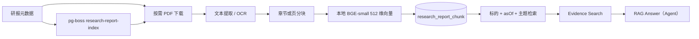

# RAG 标准

## 目的

统一研报、新闻和 Agent 的证据检索边界，区分“检索结果”与“基于检索生成的回答”，避免把普通全文搜索宣传成 RAG。

## 术语

| 术语 | 定义 |
|---|---|
| Evidence Search | 按标的、时间和主题检索原文片段，返回来源与页码，不生成自然语言结论。 |
| RAG Answer | LLM 接收检索证据后生成回答，并逐条引用实际使用的标题、机构、日期和页码。 |

RAG 只指第二种。个股分析页的主题检索属于 Evidence Search；研报检索工具被 Agent 调用并生成带引用回答时，才属于 RAG Answer。

## 当前范围

- **研报 RAG：首批链路可用。** 只有 PDF 已提取、分块并生成向量的研报可参与语义检索；未完成全文的研报仍可通过元数据和关键词降级被发现。
- **新闻 RAG：未启用。** 新闻当前用于个股关联、时间线和事件阅读，不生成新闻向量。
- `news_embedding` 是保留表，不是生产 RAG 路径。任何新闻 RAG 方案必须另行完成数据、检索、权限和评测设计后才能启用。

## 研报接入与全文补全

- **自选股元数据**：交易日 `18:10` 由 `stock-research-reports` 同步最近 12 个月元数据，进入分析页时直接读取数据库。
- **非自选股元数据**：首次进入分析页时，后台为该标的触发一次元数据同步；同一标的 24 小时内不因重复进入反复请求上游，用户主动“重新分析”可强制增量刷新。
- **全文补全**：元数据可用后，后台自动提取 `publish_date >= current_date - 30 days` 的全部研报，不限制篇数，也不阻塞页面首屏。
- **队列与恢复**：独立 `research-worker` 消费 pg-boss `research-report-index`，全局并发 1；`pending` 超过 10 分钟会在启动时和每 10 分钟重新入队。
- **幂等**：已成功提取的研报跳过；仅在 `report_id`、提取器版本或分块版本变化时重建。
- **并发**：全局同时只处理 1 篇 PDF。当前分析页请求优先于自选股后台批次。
- **失败**：自动重试最多 3 次并递增间隔；仍失败时保留元数据和原文链接，页面可显示失败状态并允许手动重试。

## 数据链路

- 研报元数据按自选股定时同步，非自选股首次分析按需同步。
- 自动全文补全只覆盖当前分析标的最近 30 天，不做全市场无差别抓取。
- PDF 二进制保存在 `reports-data`，PostgreSQL 保存存储键、哈希、页数、全文、分块和向量。
- 分块必须保留 `report_id`、页码、章节、分块版本和原文片段。

## 检索契约

- 研报语义检索必须先按 `symbol` 过滤；传入 `asOf` 时只允许 `publish_date <= asOf` 的研报。
- 检索结果只包含 `embedding IS NOT NULL` 的分块，按余弦距离排序并限制返回数量。
- 向量不可用、向量查询异常或返回空结果时，必须继续尝试关键词检索；不能直接返回空结果。
- 低相关结果不得强行注入 Prompt。没有足够证据时应明确返回“证据不足”。
- 每条证据至少包含：研报 ID、来源 ID、标题、机构、发布日期、页码、原文片段和相似度；关键词模式相似度为 `null`。
- 首批检索基线：Evidence Search 返回 Top 8，Agent 注入 Top 5；当前检索版本为 `hybrid-keyword-v1`，未设置硬相似度阈值。
- 关键词降级按空白分词，每个词项都需在标题或原文中命中。
- Golden Set 位于 `apps/server/src/agent/mastra/fixtures/research-rag-golden-set.json`，使用比亚迪和贵州茅台共 21 条查询；运行 `pnpm --filter @ai-trader/server eval:research-rag` 输出基线，增加 `-- --enforce` 才把失败作为非零退出。
- 2026-11-20 基线：全文入库后语义模式 19/21 进入 Top 8，强制向量不可用时关键词模式 21/21；该结果用于后续校准，不替代人工复核。

## 回答契约

- RAG Answer 中的研报观点必须引用实际返回的证据，不得虚构标题、机构、页码或原文。
- 行情、技术指标、估值区间和情景分布只能引用确定性计算结果。
- LLM 不得生成目标价、保证收益或“安全价格”。
- 证据冲突时应并列说明不同来源，不自行选择对结论更有利的一方。

## 权限与审计

- PDF、全文、分块和检索接口只对已登录用户开放。
- Agent 只能通过受控工具查询 RAG，不接受模型生成的任意 SQL。
- 工具结果必须带来源、时间、实体 ID 和可追溯页码。
- 检索失败、向量为空、关键词降级和证据不足应记录为可观察状态。

## 非目标

- 不把新闻标题直接视为研报观点。
- 不在未设计评测、权限和来源追踪前启用新闻 RAG。
- 不为全市场自动提取全部 PDF。
- 不把 `news_embedding` 的旧实现复用于研报。

## 相关文档

- [ADR 0005：个股分析采用确定性计算与研报 RAG 分离](../adr/0005-stock-analysis-and-report-rag.md)
- [个股分析技术设计](../superpowers/specs/2026-11-19-stock-analysis-design.md)
- [研报文档 OpenSpec](../../openspec/changes/add-stock-analysis-workbench/specs/stock-research-documents/spec.md)
- [数据库标准](./database.md)
- [Agent 标准](./agent.md)
