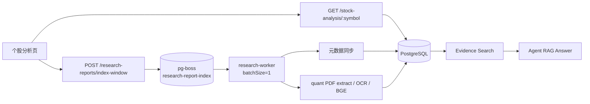

# 研报 RAG 自动补全与检索实现设计

## Intent

把当前“有研报检索代码、没有可用向量”的状态补成真实可用的研报研究链路：自选股直接读取收盘后同步的元数据，任意个股首次分析时后台补元数据，随后自动补全最近 30 天研报全文与向量。个股分析页保持确定性摘要和只读首屏，AI 助手只在调用检索工具时生成带引用的 RAG Answer。

## Goals

- 自选股元数据由定时任务提供，进入分析页直接读本地数据。
- 非自选股首次分析后台补一次元数据，24 小时内不重复请求。
- 最近 30 天全部研报自动提取、OCR、分块和向量化。
- 页面不被 PDF/OCR 阻塞，并且能看到索引进度与失败。
- 语义检索为空时自动降级关键词。
- Top 8 Evidence Search、Top 5 Agent 证据和 Golden Set 验证。
- 新闻 RAG 保持关闭。

## Non-Goals

- 不做全市场 PDF 自动抓取。
- 不让 LLM 生成价格、目标价或安全价格。
- 不在这项变更中重做个股分析页面视觉语言。
- 不启用 `news_embedding` 或旧新闻 RAG 查询代码。

## Current State

- `stock-research-reports` 每个工作日 `18:10` 为自选股同步最近 12 个月元数据。
- 个股分析 GET 只读 PostgreSQL，不触发上游请求。
- “重新分析”同步元数据，但不提取 PDF。
- 单篇“提取全文”同步执行 quant PDF 提取，成功后才写入分块和向量。
- 当前本地数据库有 41 篇研报元数据，但 PDF、分块和研报向量均为 0；新闻向量也为 0。
- 研报 API 与 Agent 工具已有向量检索；但语义查询返回空集合时不会降级关键词。
- `news_embedding` 旧 RAG 代码无人调用，查询的表名也与 schema 不一致。

## Approaches

### A. API 进程内异步执行（拒绝）

在 Hono 请求进程中使用 `void promise` 做 PDF 提取。代码最少，但进程重启会丢任务，OCR 会抢占 API CPU，无法可靠限并发。

### B. 复用 workflow-worker（拒绝）

把研报索引作为现有工作流队列中的一种 job。部署最少，但会混淆工作流运行语义和研报索引状态，大批 PDF 可能阻塞用户的工作流执行。

### C. 独立 research-worker + pg-boss（采用）

新增专用 worker 容器和队列，`batchSize: 1` 全局串行。任务可持久恢复、可设置优先级、可独立扩缩容和回滚。代价是多一个容器和少量部署配置，但这与 PDF/OCR 的 CPU 特征相符。

## Architecture



## Trigger Model

### Watchlist

继续使用现有 `stock-research-reports` 工作日 `18:10` 任务。进入分析页时只读元数据；若最近 30 天研报尚未索引，页面调用独立 POST 入队。

### Non-watchlist first analysis

分析 GET 返回 `reportIndex.action = sync_metadata`。页面在读取完成后调用同一入队接口。worker 先同步该标的最近 12 个月元数据，再根据最新元数据入队最近 30 天全文任务。该标的元数据任务使用 24 小时 singleton key。

### Manual refresh

“重新分析”继续强制增量同步元数据，但不等待 PDF 提取。全文索引仍然异步执行。

## Queue Contract

```ts
type ResearchIndexJob =
  | { kind: "metadata"; symbol: string; trigger: "analysis" | "manual" }
  | { kind: "report"; reportId: number; symbol: string; trigger: "analysis" | "manual" };
```

- Queue：`research-report-index`
- Worker：`batchSize: 1`
- 页面触发：高优先级
- 定时/后台：普通优先级
- metadata singleton key：`research-metadata:${symbol}`
- report singleton key：`research-index:${reportId}:${extractorVersion}:${chunkVersion}`
- 自动重试：3 次，递增间隔

## Indexing Flow

1. 查询最近 30 天研报元数据。
2. 对没有成功文档的研报创建或复用 `research_report_document(extract_status=pending)` 占位行。
3. 单篇 worker 调用 quant 提取接口。
4. quant 下载并校验 PDF，提取文本，低密度页 OCR，分块，本地 BGE 生成 512 维向量。
5. server 更新文档为 `extracted`，替换该报告当前分块。
6. 提取失败写 `failed + last_error`；成功报告后续跳过。

如果文档已经 `extracted`，只有提取器版本或分块版本变化时才重建。

## API

### 只读分析响应

```ts
reportIndex: {
  windowDays: 30;
  total: number;
  pending: number;
  extracted: number;
  failed: number;
  action: "sync_metadata" | "index_reports" | "none";
  observedAt: string;
}
```

动作判定：

- 本地没有元数据或最近同步超过 24 小时：`sync_metadata`
- 存在 pending 或从未尝试全文的研报：`index_reports`
- 仅存在 failed：`none`，保留失败状态，由用户手动重试
- 全部成功且版本一致：`none`

### 入队

```text
POST /api/v1/research-reports/index-window
{ "symbol": "002594.SZ", "days": 30 }
```

返回 `202`、任务 ID、当前状态。所有接口要求登录。

### 单篇提取

`POST /api/v1/research-reports/:id/ingest` 改为同一队列入队，返回 `202`。已成功项返回当前状态。

## Retrieval

- 过滤：`symbol`、可选 `publish_date <= asOf`、`embedding IS NOT NULL`。
- Evidence Search：Top 8，返回标题、机构、发布日期、页码、片段和相似度。
- Agent：Top 5，回答必须引用实际证据。
- 语义失败或零结果：关键词检索，保留相同返回结构，`similarity=null`。
- 未完成 Golden Set 前不设硬阈值。

## Golden Set

使用 `002594.SZ` 与 `600519.SH`，准备不少于 20 条查询-证据样本：

- 主题应命中指定研报页码。
- 无相关证据时明确返回空或证据不足。
- 元数据存在但无全文时不伪装成 RAG。
- 历史 `asOf` 不返回未来研报。
- 不允许模型引用不存在的标题、页码或片段。

验收标准：

- 每条正样本至少命中一个预期证据。
- 所有 RAG Answer 引用可回溯到工具返回。
- 关键词降级在语义空结果时触发。
- 阈值只有在结果记录后才可固化为规则版本。

## Worker Recovery

- pg-boss 任务持久化。
- worker 启动时扫描长期 `pending` 文档并重新入队。
- 重试耗尽后写 `failed`，不自动无限重试。
- worker 停止不删除 PDF、全文、分块或向量。

## Visual Design

复用现有五格“研报全文”状态项：

- 暂无
- `7 篇待索引`
- `索引中 3/7`
- `已索引 7 篇`
- `已索引 5 篇 · 2 失败`

探索稿目标路径：

```text
docs/design/prototypes/explorations/quant-workbench-research-rag-v1.html
docs/design/prototypes/explorations/screenshots/research-rag-v1/
```

必须覆盖桌面、移动端、浅色、深色、加载、空、错误、部分成功和 Evidence Search 空态，并获得用户确认后才写生产代码。

## Rollout

1. 上线 research-worker 和队列，不启用页面自动入队。
2. 上线只读索引状态与入队 API，内部验证 BYD。
3. 上线页面自动触发和状态轮询。
4. 切换单篇提取到队列。
5. 完成 Golden Set 后再考虑阈值和新闻 RAG。

## Rollback

- 停止 research-worker。
- 关闭页面自动入队接口。
- 保留已写入的 PDF、全文、分块和向量。
- 语义检索可临时强制关键词模式，不影响研报元数据读取。

## Risks

| 风险 | 缓解 |
|---|---|
| 单月研报过多 | 串行队列、进度可见；实测超过 50 篇再评估保护上限 |
| OCR 占满 CPU | 独立 worker、并发 1、低峰执行 |
| worker 重启丢任务 | pg-boss 持久化 + pending 重入队 |
| 低质量 OCR 污染证据 | 失败不标 `extracted`，不进入检索 |
| 空向量被误报无结果 | 空结果和异常都走关键词降级 |
| Golden Set 过拟合 | 两只股票、负样本、历史 asOf、版本化阈值 |
