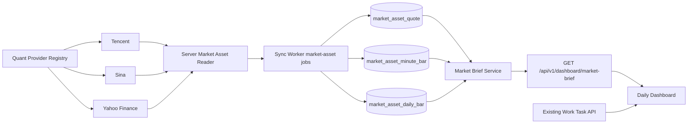

# 每日看板跨资产行情与市场信号设计

## Intent

把每日看板首屏升级为盘前与盘中决策入口：A 股主控台集中展示上证指数、创业板指、趋势图和确定性市场信号；主流 ETF 使用独立 Tab 观察卡，伦敦金与纳指使用独立跨市场背景卡；今日行动与今日工作流组成首屏下方的今日执行区。

用户确认的 v6 视觉稿强调：左侧大尺寸 A 股趋势与信号，右侧跨市场背景和主流 ETF 两张同级观察卡，今日行动与今日工作流在下方并列执行。

## Confirmed Decisions

- 保留现有市场主线、市场温度、每日选股、工作流、资讯和复盘模块，新内容位于首屏，旧模块下沉。
- 固定展示 `000001.SH`、`399006.SZ`、`510300.SH`、`588000.SH`、`159992.SZ`、`XAUUSD` 和 `IXIC`。
- A 股主控台默认上证指数，可切换创业板指；三个 A 股 ETF 使用独立 Tab 卡，不改变 A 股风险信号。
- A 股图、ETF 图和跨市场图分别拥有自己的 `1D/5D/1M/YTD` 区间。
- 伦敦金与纳指不进入 A 股主图，使用独立跨市场背景卡展示，避免把跨市场走势与 A 股风险信号误读为同一判断。
- 桌面端右侧跨市场卡与 ETF 卡作为同一列拉伸，两卡总高度与左侧 A 股主控台一致；移动端自然单列。
- 每个资产使用自己的交易时段。A 股横轴为 `09:30–11:30 / 13:00–15:00`；伦敦金使用连续交易时段。
- 伦敦金没有可信成交量，黄金图隐藏成交量柱，不补零伪装；纳指跨市场视图不将成交量作为判断依据。
- 首期不做无法校准的等权基准和量价事件标注。
- 市场信号只表达 A 股状态；伦敦金只作为跨资产背景，不进入 A 股趋势分、热度分或数据置信度。
- 分数由确定性规则计算，文案由确定性模板归纳证据；不使用 LLM 生成判断或数字。
- 数据置信度只表达数据新鲜度和完整度，不表示方向预测准确率。
- 今日行动直接绑定当前用户今日 Work Task，按 `dueTime` 排序，不混入 Workflow Run。
- 今日工作流独立绑定当前用户今日 Workflow Run，不混入 Work Task；今日行动与今日工作流在今日执行区并列展示。
- 分钟线前向采集，保留最近 13 个月；日线可回填，历史分钟缺口必须明确显示。

## Goals

- 在不污染 A 股 K 线、复权和回测契约的前提下建立小范围跨资产行情能力。
- 三个固定资产提供统一报价、分钟线、日线、质量与来源元数据。
- 分钟任务幂等、可重跑、失败可观察，跨午夜时使用绝对时间避免日期错位。
- 页面首屏只依赖少量聚合请求；用户任务与共享行情缓存分离。
- 所有可见判断可追溯到结构化指标。

## Non-Goals

- 不建设全市场股票分钟线平台。
- 不把指数或伦敦金写入 `bar1d_raw`、`bar1m_adj`、`bar1d_qfq` 或 `load_kline` 契约。
- 不提供黄金期货、黄金 ETF、上海金或人民币/克报价。
- 不做等权指数、事件检测或自动交易。
- 不让用户动态增删行情标的；首批资产由代码 allowlist 固定。

## Anti-Goals

- 缺失时显示 0、沿用旧价但标成实时，或用假分钟点补齐。
- 把 XAU/USD 与人民币/克上海金混为同一资产。
- 让 LLM 自由生成趋势分、热度分或置信度。
- 在共享行情缓存中混入某个用户的任务数据。

## Current Findings

- `/api/v1/dashboard` 当前只聚合板块广度、资金流、涨停、选股、资讯和复盘。
- 现有 `instrument` 与 `bar1d_raw` 没有三大目标资产的完整历史。
- 腾讯支持上证、创业板实时报价和当日分钟线。
- 腾讯 `hf_XAU` 返回伦敦金实时报价；新浪支持 XAU 分钟线与日线。
- 伦敦金分钟线和日线没有有效成交量。
- `kline-1m` 入库任务当前是未启用空壳，不能直接复用。
- 今日 Work Task 与交易日历已有后端能力；日历信息尚未进入 dashboard 响应。

## Approaches Considered

### A. Frontend composes existing APIs

前端分别请求指数、黄金和任务接口。改动较小，但存在请求瀑布、黄金缺契约、长区间无稳定缓存的问题，排除。

### B. Market Brief aggregation with hybrid live/cache

服务端聚合实时报价和按需日线，只缓存页面所需数据。适合首屏，但不形成正式分钟数据资产。

### C. Formal cross-asset market data platform — selected

增加正式 Provider 能力、独立跨资产表、分钟采集、日线回填、质量规则和聚合 API。成本较高，但数据可复用、可审计、可回滚。

## Architecture



## Fixed Asset Catalog

资产目录由代码维护，不提供管理端编辑：

```ts
type MarketAsset = {
  symbol: "000001.SH" | "399006.SZ" | "510300.SH" | "588000.SH" | "159992.SZ" | "XAUUSD" | "IXIC";
  name: string;
  kind: "a_share_index" | "a_share_etf" | "spot_gold" | "global_index";
  currency: "CNY" | "USD";
  priceUnit: "index_point" | "CNY" | "USD/oz";
  displayTimezone: "Asia/Shanghai";
  providerSymbol: string;
  session: "a_share" | "global_gold" | "us_equity";
  hasVolume: boolean;
};
```

| Public symbol | 名称 | Provider symbol | 单位 | 成交量 |
|---|---|---|---|---|
| `000001.SH` | 上证指数 | `sh000001` | 点 | 有 |
| `399006.SZ` | 创业板指 | `sz399006` | 点 | 有 |
| `510300.SH` | 沪深300ETF | `sh510300` | 元 | 有 |
| `588000.SH` | 科创50ETF | `sh588000` | 元 | 有 |
| `159992.SZ` | 创新药ETF | `sz159992` | 元 | 有 |
| `XAUUSD` | 伦敦金 | `hf_XAU` / `XAU` | USD/oz | 无 |
| `IXIC` | 纳斯达克综合指数 | `usIXIC` / `us.IXIC` | 点 | 无 |

## Provider Contract

quant 数据层新增三个能力，不把跨资产塞入股票 `quote/kline`：

```python
CAPABILITY_MARKET_ASSET_QUOTE = "market_asset_quote"
CAPABILITY_MARKET_ASSET_MINUTE = "market_asset_minute"
CAPABILITY_MARKET_ASSET_DAILY = "market_asset_daily"
```

统一类型：

```python
class MarketAssetQuote:
    symbol: str
    price: float
    pre_close: float | None
    open: float | None
    high: float | None
    low: float | None
    change_pct: float | None
    volume: float | None
    amount: float | None
    quoted_at: datetime
    source: str

class MarketAssetBar:
    symbol: str
    session_date: date
    bucket_start: datetime
    open: float
    high: float
    low: float
    close: float
    volume: float | None
    amount: float | None
    source: str
```

Provider 分配：

- 腾讯实现七个资产的实时报价。
- 腾讯实现上证、创业板和三个 A 股 ETF 的分钟线与日线。
- 新浪实现 XAU 分钟线与日线。
- `IXIC` 使用腾讯报价和 Yahoo `^IXIC` 5 分钟/日线作为跨市场时间序列来源。
- 新浪是 XAU 日线唯一源；provider 对不支持资产显式抛错，不返回空数组冒充成功。

## Persistence

新建独立表，保持与 A 股复权、回测表隔离。

### `market_asset_quote`

```text
symbol text primary key
price numeric(20,6) not null
pre_close/open/high/low numeric(20,6)
change_pct numeric(12,6)
volume/amount numeric(24,4)
quoted_at timestamptz not null
observed_at timestamptz not null
source text not null
quality text not null
fallback_reason text
raw jsonb
```

### `market_asset_minute_bar`

```text
symbol text not null
session_date date not null
bucket_start timestamptz not null
open/high/low/close numeric(20,6) not null
volume/amount numeric(24,4)
source text not null
observed_at timestamptz not null
primary key(symbol, bucket_start)
index(symbol, bucket_start desc)
index(session_date)
```

分钟时间使用绝对时间 `timestamptz`；`session_date` 单独用于跨午夜伦敦金分组。

### `market_asset_daily_bar`

```text
symbol text not null
trade_date date not null
open/high/low/close numeric(20,6) not null
volume/amount numeric(24,4)
source text not null
observed_at timestamptz not null
primary key(symbol, trade_date)
```

### Retention

- 分钟线保留 13 个月，每日低峰删除更早数据。
- 日线不自动删除。
- 当前 7 个资产预计 13 个月分钟线规模仍可控，首期不做年度分区。
- 不建立历史分钟回填任务。

## Ingestion Jobs

### `market-asset-minute`

- cron 每分钟一次。
- A 股仅在交易日 `09:30–11:30 / 13:00–15:00` 取数。
- 上证、创业板和三个 A 股 ETF 按 A 股交易时段取数。
- XAU 按 Provider 返回的连续交易时段取数，接受跨午夜 `session_date`。
- `IXIC` 使用 5 分钟桶，避免按秒级实时口径承诺无法稳定获得的超短周期数据。
- 每次抓取当日全部分钟点并按 `(symbol, bucket_start)` upsert。
- 单资产失败不连累其他资产；任务结果允许部分成功。

### `market-asset-daily`

- cron 每天 `06:10` 和 `16:10` 各运行一次。
- 抓取最近窗口并 upsert；A 股、XAU 与 IXIC 独立成功。
- 首次安装执行日线历史回填；各来源按实际覆盖起点回填，不补造缺失日期。

### `market-asset-retention`

- 每天低峰执行。
- 删除 `bucket_start < now - 13 months` 的分钟数据。
- 只清理新表，不触碰股票、复权或回测数据。

## Market Brief API

```text
GET /api/v1/dashboard/market-brief?symbol=000001.SH&range=1D&etfSymbol=510300.SH&etfRange=1D&globalSymbol=XAUUSD&globalRange=1D
```

- `symbol`: A 股 allowlist `000001.SH | 399006.SZ`，默认 `000001.SH`
- `range`: A 股图 `1D | 5D | 1M | YTD`
- `etfSymbol`: ETF allowlist `510300.SH | 588000.SH | 159992.SZ`，默认 `510300.SH`
- `etfRange`: 独立 ETF 图 `1D | 5D | 1M | YTD`
- `globalSymbol`: 跨市场 allowlist `XAUUSD | IXIC`，默认 `XAUUSD`
- `globalRange`: 独立跨市场图 `1D | 5D | 1M | YTD`

```ts
type MarketBriefResponse = {
  asOf: string | null;
  aShareSession: {
    phase: "pre_open" | "morning_open" | "midday_break" | "afternoon_open" | "closed" | "non_trading_day";
    label: string;
    tradeDate: string | null;
    nextEventLabel: string | null;
    nextEventAt: string | null;
  };
  tickers: Array<{
    symbol: string;
    name: string;
    price: number | null;
    changePct: number | null;
    priceUnit: string;
    asOf: string | null;
    quality: "available" | "low" | "missing";
    source: string;
    staleReason: string | null;
  }>;
  aShareChart: {
    symbol: string;
    range: "1D" | "5D" | "1M" | "YTD";
    timezone: "Asia/Shanghai";
    sessionDate: string | null;
    hasVolume: boolean;
    points: Array<{ time: string; price: number; volume: number | null }>;
    quality: "available" | "low" | "missing";
    staleReason: string | null;
  };
  etfChart: {
    symbol: "510300.SH" | "588000.SH" | "159992.SZ";
    range: "1D" | "5D" | "1M" | "YTD";
    timezone: "Asia/Shanghai";
    sessionDate: string | null;
    hasVolume: true;
    points: Array<{ time: string; price: number; volume: number | null }>;
    quality: "available" | "low" | "missing";
    staleReason: string | null;
  };
  globalChart: {
    symbol: "XAUUSD" | "IXIC";
    range: "1D" | "5D" | "1M" | "YTD";
    timezone: "Asia/Shanghai";
    sessionDate: string | null;
    hasVolume: false;
    points: Array<{ time: string; price: number; volume: number | null }>;
    quality: "available" | "low" | "missing";
    staleReason: string | null;
  };
  signal: {
    stance: "risk_on" | "neutral" | "risk_off";
    headline: string;
    body: string;
    dataConfidence: number;
    factors: Array<{
      key: "trend" | "breadth" | "heat";
      label: string;
      score: number;
      evidence: string;
    }>;
    modelVersion: string;
    asOf: string | null;
    quality: "available" | "low" | "missing";
  };
};
```

用户任务不进入该响应。前端并行调用现有 `/api/v1/work-tasks?view=today`，避免个人数据进入共享行情缓存。

今日工作流同样不进入该响应。前端并行调用现有 `/api/v1/workflows/runs/today`，并用 Workflow 列表补齐活跃流程数量。

## Market Signal

确定性规则第一版：

- 统一使用 `clamp(value, 0, 100)`。
- `trend`：
  - `closeVsMa20Pct = (selectedClose / ma20 - 1) * 100`
  - `return20Pct = (selectedClose / close20Ago - 1) * 100`
  - `trend = clamp(50 + closeVsMa20Pct * 4 + return20Pct * 2 + dayChangePct * 3, 0, 100)`
- `breadth = clamp(risingIndustryRatio * 60 + positiveFundFlowRatio * 40, 0, 100)`
- `heat = clamp(min(limitUpTotal, 100) * 0.5 + min(maxBoard * 10, 100) * 0.25 + min(avgTurnover * 10, 100) * 0.25, 0, 100)`
- `overall = trend * 0.5 + breadth * 0.3 + heat * 0.2`
- `dataConfidence`：A 股 ticker 新鲜度 25、自选 A 股报价 25、A 股图点数覆盖 25、广度和涨停输入完整度 25；伦敦金数据质量不进入该分数。
- `stance`：`overall >=65` 为 `risk_on`，`<=35` 为 `risk_off`，其余 `neutral`。
- 任一核心因子缺失时 `signal.quality=low`；两项及以上缺失或 `dataConfidence<40` 时 `signal.quality=missing`、`stance=neutral`，正文显示“证据不足”，不生成方向判断。
- 标题与正文使用固定模板；每个因子包含结构化 evidence。
- 伦敦金只生成跨资产背景说明，不调整 A 股分数。

`modelVersion` 首版为 `dashboard-signal-v1`。公式或阈值变化必须提升版本并补测试。

## Caching

- quote：15 秒。
- 1D minute：30 秒。
- 5D/1M/YTD daily：5 分钟。
- Market Signal：60 秒。
- 缓存只按共享市场参数，不包含用户身份。
- 上游失败时读取最后数据库快照，但必须返回 stale。

## Frontend

新增组件：

- `AShareMarketBoard`: 上证/创业板切换、A 股趋势图、成交量和 SIGNAL。
- `AShareSignalPanel`: 标题、正文、三项 Deterministic Factor、数据质量和“追问 AI”入口。
- `ETFContextCard`: 三个主流 ETF 的横向 Tab、独立报价、区间和走势，明确不进入 A 股 SIGNAL。
- `GlobalContextCard`: 伦敦金与纳指 Tab、独立报价、区间和走势，明确不进入 A 股信号。
- `TodayExecutionSection`: 今日行动与今日工作流并列；行动读取 Work Task，工作流读取 Workflow Run。

现有 `DailyDashboard` 模块保留并下沉。查询并行：

- `useMarketBriefQuery({ symbol, range, etfSymbol, etfRange, globalSymbol, globalRange })`
- `useWorkTasks("today", localDate, timezone)`
- `useTodayWorkflowRunsQuery()`
- `useWorkflowsQuery()`

页面状态：

- Market Brief 成功：完整首屏。
- 单个 A 股缺失：A 股主控台显示“暂不可用”，黄金卡和任务继续。
- ETF 缺失：独立 ETF 卡显示“暂不可用”或陈旧，A 股主控台继续。
- 跨市场缺失：独立跨市场卡显示“暂不可用”或陈旧，A 股主控台继续。
- 图表缺失：对应卡片显示最后可信快照或空态，不显示空坐标。
- 信号缺失：显示“证据不足”，不生成判断。
- 今日任务缺失：显示任务空态。
- 今日工作流失败：只显示工作流错误/重试，不影响市场和今日行动。
- AI 追问：打开现有助手，自动带入当前 A 股信号和所选指数/ETF 上下文，不执行交易或修改任务。
- 桌面端：右侧两张观察卡合计高度与左侧主控台一致，底边差值为 0。
- 移动端：A 股主控台、跨市场卡、ETF 卡、今日执行依次单列。

## Visual Design Gate

进入生产代码前必须：

已确认：`explorations/quant-workbench-dashboard-market-radar-v6.html`。

- 使用真实 `000001.SH / 399006.SZ / XAUUSD / IXIC / 三个 ETF` 样例。
- 覆盖指数切换、ETF Tab 与方向键、跨市场 Tab、三图独立区间、缺失、陈旧、SIGNAL 降级、今日行动和今日工作流。
- 截图覆盖桌面/移动端、浅色/深色和键盘状态。
- 用户已于 2026-11-22 确认 v6；生产实现不得改变模块归属、Tab 交互和等高关系。

## Security and Ownership

- Market Brief 不包含用户数据，不信任客户端 user id。
- Work Task 继续由 Better Auth Session 和 owner 校验。
- Provider 端点只由 server/quant 访问。
- raw provider 响应不返回浏览器，只返回结构化白名单字段。

## Testing

- Provider parser fixture：腾讯指数分时、腾讯 XAU 报价、Sina XAU 分时和日线。
- Registry chain：资产支持能力、主备源、未知资产拒绝。
- Ingestion：幂等 upsert、跨午夜 session_date、单资产失败不连累其他资产。
- Retention：13 个月边界和日线不影响。
- Market Signal：阈值、数据不足、陈旧、确定性文案和版本。
- API：全部配置资产报价、A 股/ETF/跨市场三图独立区间、缺失/部分成功、缓存隔离。
- Frontend pure helpers：单位、断点、三组图表区间、ETF Tab 方向键、任务与 Workflow Run 排序。
- 真实浏览器：桌面/移动端、深浅色、键盘、空态和部分成功。
- 布局：桌面左右高度与底边完全对齐，移动端不强制等高。

## Deployment and Rollback

1. 应用 additive migration，旧看板不受影响。
2. 部署 Provider 与测试端点，不启用分钟 cron。
3. 执行日线回填，开始分钟采集并观察质量。
4. 部署 Market Brief API。
5. 前端视觉稿确认后切换新首屏。

新首屏受 `DASHBOARD_MARKET_RADAR_ENABLED` 控制；默认关闭，验证通过后开启。关闭时继续显示当前每日看板。

回滚：

- 新前端通过 feature flag 回退旧看板。
- 停用三个 market-asset cron 即停止采集。
- 表保持只读，不删除已采数据。
- 现有 `/dashboard`、A 股 K 线、复权和回测链路不变。

## Open Questions

无。SQL 写法、缓存数据结构和 ECharts 选项由实施计划决定，但不得改变本设计的资产口径、数据边界和降级原则。
