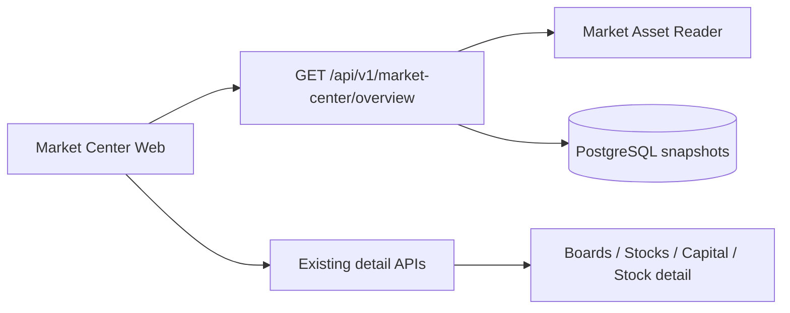

# Design

## Context

动机与范围见 [proposal.md](./proposal.md)，可观察行为见 [market-center spec](./specs/market-center/spec.md) 和 [preline-workbench-ui delta](./specs/preline-workbench-ui/spec.md)。

当前系统已有可复用的行情与明细能力：

- `/home` 每日看板已实现行情雷达、行业广度、资金主线、市场温度、选股、任务、资讯和复盘。
- `/home/market` 目前是开发占位页。
- `/home/market/boards`、`/home/market/stock`、`/home/market/stock/$symbol` 和 `/home/market/analysis/*` 已有真实实现。
- `/home/signals/heatmap` 与 `/home/signals/fundflow` 已实现但不在侧栏展示。
- Server 已有 `dashboard`、`dashboard/market-brief`、`boards`、`fundflow`、`heatmap`、`instruments`、`watchlist`、`kline`、`stock-analysis` 等只读或用户隔离接口。
- 市场资产、板块历史、资金流和涨停池已经独立落库；行业/概念与跨资产轮动可复用这些数据。
- 成长 / 防守轮动需要的创业板50与红利低波100完整日线尚未进入固定资产目录，需要按独立指数 Provider 接入。

轮动和异动都拆入既有上下文，一级模块收敛为“总览、板块、个股”。可保存行情看板、订阅提醒和自动交易继续排除。

## Goals / Non-Goals

**Goals:**

- 用一条低延迟的只读聚合请求完成行情中心总览首屏，避免前端串行拼装多个数据域。
- 保持板块、个股、资金流和价格图的明细接口独立，只有用户进入对应上下文时才加载完整数据。
- 让每个数据域拥有独立的新鲜度、空态、错误和重试状态。
- 在不破坏旧深链接的前提下，将行情中心及其模块统一到一个可深链访问的路由层级。
- 为后续视觉探索提供稳定的数据契约、路由契约和回滚边界。
- 在不新增一级模块的前提下，把成长/防守、行业、概念和大类资产轮动放回其观察对象。

**Non-Goals:**

- 不新增“轮动”或“资金与异动”一级模块，不把同一分析复制成独立页面。
- 一期大类资产轮动不宣称覆盖债券与现金；这两类资产需要单独的数据契约。
- 不在本变更中实现自动异动推送或可订阅告警。
- 不把全市场个股、板块成分或完整分钟线聚合进首屏接口。
- 不引入新的数据库表、物化视图、后台刷新任务或外部数据依赖。
- 不改变现有每日看板、个股分析、每日选股、复盘和工作流的核心业务契约。
- 不在视觉稿确认前写生产 UI 或把探索稿当成已批准方案。

## Decisions

### 1. Use a server-side overview aggregator plus existing detail APIs

行情中心首屏新增只读接口 `GET /api/v1/market-center/overview`，由 Server 内部复用现有 Reader 和数据库查询。板块列表、个股搜索、自选、资金流排行、热力图、K 线和个股分析继续使用各自现有接口。



选择理由：

- 首屏只发起一条聚合请求，减少指数、板块、资金和涨停之间的请求瀑布。
- 聚合层不替用户预取大列表，避免把首屏变成全市场接口。
- 现有明细接口已有缓存、分页和测试，不需要复制查询逻辑。

替代方案：

- **前端独立拼多接口**：实现最少，但首屏失败状态和加载时序更碎，容易出现多个 spinner 和重复请求。
- **统一行情查询服务或物化快照**：吞吐最好，但引入额外后台任务、存储一致性和运维面，超出 MVP。

### 2. Keep the overview response narrow and section-addressable

聚合响应只包含行情中心总览和资金异动摘要需要的字段：

```ts
type MarketCenterOverviewResponse = {
  generatedAt: string;
  asOf: {
    quotes: string | null;
    boards: string | null;
    fundFlow: string | null;
    limitUp: string | null;
  };
  session: AShareSession;
  quotes: {
    status: PageSectionStatus;
    items: MarketTick[];
    staleReason: string | null;
  };
  breadth: {
    status: PageSectionStatus;
    industry: BreadthCount;
    concept: BreadthCount;
    asOf: string | null;
  };
  temperature: {
    status: PageSectionStatus;
    asOf: string | null;
    total: number | null;
    maxBoard: number | null;
    maxSealAmount: number | null;
    avgTurnover: number | null;
    openedCount: number | null;
    leaders: LimitUpLeader[];
  };
  anomalies: {
    status: PageSectionStatus;
    items: Array<{
      ruleId: string;
      title: string;
      evidence: string;
      category: "industry" | "concept" | "limit_up";
      asOf: string;
      href: string;
    }>;
  };
};

type PageSectionStatus = "available" | "low" | "missing" | "error";
```

约束：

- 不返回板块全量、成分股、个股全量、K 线或用户自选。
- 不返回任务、工作流、资讯、复盘或每日选股。
- 不返回用户 ID；共享聚合响应不得缓存用户数据。
- `price`、日期和金额沿用现有 API 的数值语义；缺失值保持 `null`，不转换为 0。

### 3. Treat partial success as the normal contract

聚合服务内部按数据域使用 `Promise.allSettled` 并发读取，每个域单独收敛为 `available | low | missing | error`：

- 至少一个域可用时返回 HTTP 200，响应中保留其他域的真实空态或错误态。
- 三个业务域全部不可用时返回 HTTP 503，前端展示总览错误，但模块导航仍可用。
- 单个域失败不得让总览整页卸载，也不得清空其他域旧数据。
- 每个模块仍可单独触发 Query 重试；重试只影响该数据域。

### 4. Keep user-specific state outside the shared overview

自选股继续通过现有 `/api/v1/watchlist` 和 `/api/v1/watchlist/instruments` 读取，并沿用当前用户身份边界：

- `market-center/overview` 不包含用户 ID、自选列表或个性化排序。
- 自选查询不共享给其他用户，也不进入聚合接口缓存。
- 个股搜索、行情列表和用户自选在同一个“个股”模块内分区，但使用独立 Query key 和失败状态。

### 5. Use deterministic anomaly rules inside the boards module

板块页的同屏异动区域只表示可解释的资金或涨停结构极值，不表示预测：

- 行业主力净流入排名首项和末项。
- 概念主力净流入排名首项和末项。
- 涨停池中封板数量排名前三的行业。

每条结果必须返回 `ruleId`、结构化证据、快照时间和可下钻目标。规则不足、样本为空或数据过期时显示空态/低质量提示，不生成自然语言排行。规则集合集中在一处纯函数中，便于单元测试和后续扩展。

### 6. Use route-backed modules instead of client-only tabs

行情中心模块使用可深链的路由，而不是只存储在 React 状态中：

| 路由 | 作用 |
|---|---|
| `/home/market` | 总览 |
| `/home/market?assetMode=rotation` | 大类资产相对强弱 |
| `/home/market/boards?type=industry` | 行业当前排行、热力图、轮动和异动同屏 |
| `/home/market/boards?type=concept` | 概念当前排行、热力图、轮动和异动同屏 |
| `/home/market/boards` | 行业/概念板块工作区默认入口 |
| `/home/market/boards/$code?type=industry\|concept` | 板块详情、轮动证据与成分股 |
| `/home/market/stock` | 个股搜索、自选和行情列表 |
| `/home/market/stock/$symbol` | 快速行情详情 |
| `/home/market/analysis/*` | 独立个股分析方法链，不作为行情中心模块 Tab |

根路由文件负责共享模块导航、页面标题和 `Outlet`；模块页只负责自身数据。切换模块使用普通 Link 导航，保证刷新、书签、浏览器历史和键盘行为一致。

### 7. Preserve old deep links with explicit compatibility

旧行情能力不能因为信息架构调整突然 404：

- `/home/market/boards` 和 `/home/market/stock` 继续作为正式模块路由。
- `/home/signals/fundflow` 兼容到当前行业或概念板块页的异动区域，并保留能映射的查询参数。
- `/home/signals/heatmap` 兼容到 `/home/market/boards` 的热力图视图，保留行业/概念选择。
- `/home/market/stock/$symbol` 与 `/home/market/analysis/*` 的实体路由不变。
- 兼容跳转必须使用 replace 语义，避免返回时落入循环；若跳转映射不完整，旧页面继续渲染而不是丢弃内容。

### 8. Add a feature flag for rollout and rollback

新增 `marketCenter` 系统功能开关，默认关闭。关闭时 `/home/market` 保留现有开发占位页，已有深链接继续按旧行为访问；开启后展示三个模块和聚合总览。

选择理由：

- 新页面和聚合接口可以先部署再灰度验证。
- 若聚合接口或视觉验收失败，可无需回滚数据库或明细接口，仅关闭开关。
- 开关不改变 Server 明细 API、旧路由或数据结构。

### 9. Preserve the daily dashboard as a decision summary

每日看板继续使用现有 `dashboard` 和 `dashboard/market-brief`：

- 市场主线、市场温度保持摘要和 Top 项。
- “查看明细”链接调整为打开对应行情中心模块。
- 不在每日看板增加全市场表格、分页、排序或板块下钻。
- 行情中心复用对比指标和格式化 helper；视觉组件可以共享，页面职责不能混用。

### 10. Navigation and breadcrumb behavior are centralized

在现有 `workbench-navigation` 中统一增加市场情报层级，不在各页面手工拼接面包屑：

- `/home/market` → `Apollo Quant / 行情中心`
- `/home/market/boards` → `Apollo Quant / 行情中心 / 板块`
- `/home/market/stock` → `Apollo Quant / 行情中心 / 个股`
- `/home/market/stock/:symbol` → `Apollo Quant / 行情中心 / 个股 / 当前标的`
- 从快速行情详情进入个股分析时使用显式来源上下文；个股分析仍保持自己的导航入口和研究职责。

移动端保留相同父子关系，具体折叠方式由视觉门禁决定。

### 11. Rotation is a derived view of an existing object

轮动不是独立资产类型，而是“对象在一组同类对象中的相对变化”：

| 轮动视图 | 所属一级模块 | 观察对象 | 一期数据 |
|---|---|---|---|
| 成长 / 防守 | 总览 | 创业板50、红利低波100 | 新增固定指数日线 Provider |
| 主要指数相对大盘 | 总览 | 沪深300、中证500、中证1000、创业板50、科创50、红利低波100；上证指数为基准 | 固定主要指数目录与共同交易日日线 |
| 行业 | 板块 | 行业板块 | `board_history`、板块资金流；与排行、热力图和异动同屏 |
| 概念 | 板块 | 概念板块 | `board_history`、板块资金流、涨停池；与排行、热力图和异动同屏 |
| 大类资产 | 总览 | A股宽基、A股成长、黄金、海外权益 | `market_asset_daily_bar` |

共同表达：

- 相对收益曲线；
- 5 / 20 / 60 日相对强弱；
- 排名及排名变化；
- 可用时的资金与涨停确认；
- 统计窗口、样本区间和数据日期。

由于轮动视图共用“相对收益 + 排名”语义，前端复用可配置展示方式，但数据由各自的分类和数据源输入，禁止把主要指数、成长/防守、行业、概念和大类资产混在同一排名中。

### 12. Add a narrow read-only rotation API

新增 `GET /api/v1/market-center/rotation`，按范围读取：

```text
scope=growth-defense|main-benchmark|industry|concept|asset
window=5D|20D|60D
```

响应结构：

```ts
type MarketRotationResponse = {
  scope: "growth-defense" | "main-benchmark" | "industry" | "concept" | "asset";
  window: "5D" | "20D" | "60D";
  asOf: string | null;
  status: "available" | "low" | "missing" | "error";
  methodology: string;
  series: Array<{
    code: string;
    name: string;
    relativeReturn: number | null;
    rank: number | null;
    rankChange: number | null;
    moneyConfirmation: number | null;
    limitUpConcentration: number | null;
    quality: "available" | "low" | "missing";
  }>;
  current: {
    state: string;
    value: number | null;
    thresholdLow: number | null;
    thresholdHigh: number | null;
    explanation: string;
  } | null;
};
```

约束：

- 行业和概念分别查询，不返回混合排名。
- 主要指数相对大盘返回共同交易日、上证基准区间收益、六项百分点超额收益和样本质量；有效风格指数少于 4 个时不生成排名。
- 大类资产一期只允许目录中的宽基、成长、黄金和海外权益；缺失资产从排名中排除并给出原因。
- 成长 / 防守使用共同基准日归一化后的相对收益；原始比值只用于展示，不直接作为跨版本通用阈值。
- 轮动接口不返回买卖指令、目标价或 LLM 生成结论。

### 13. Rotation uses explicit provider and storage boundaries

成长 / 防守指数通过新的固定指数资产接入，不写入股票 `bar1d_raw` 或回测视图：

- `399673.SZ` 可由现有腾讯能力扩展；
- `930955.CSI` 通过独立的中证指数官方日线 Provider；
- 两者写入独立的市场资产日线表或专用指数日线资产表，由轮动 Service 读取；
- 当 930955 T+1 未发布时，不把 ETF 中位数推估当成官方值静默混用；
- 一期只做观察信号，不自动生成回测任务或模拟交易。

### 14. Lists navigate to full detail pages instead of embedding detail cards

行情中心的列表是浏览界面，不承担主从详情：

- 个股列表点击一行进入 `/home/market/stock/$symbol`；列表右侧不再保留快速详情卡。
- 行业/概念当前排行、轮动或异动点击一行进入 `/home/market/boards/$code`；板块页不内嵌详情卡。
- 板块详情页展示板块行情、资金、轮动分数/排名、成分股和来源时间。
- 板块详情点击成分股进入 `/home/market/stock/$symbol`，再进入独立个股分析。
- 总览只保留摘要，不通过固定最小高度制造无内容占位区。

### 15. Main indices use a dedicated fixed index contract

“主要指数”不能继续复用 ETF 和跨市场资产集合。系统 SHALL 维护一个独立的主要指数目录，同时保持每日看板现有固定资产集合不变：

| 顺序 | 名称 | 代码 | 角色 | 定位 |
|---|---|---|---|---|
| 1 | 上证指数 | `000001.SH` | 市场基准 | 全宽独立行 |
| 2 | 沪深300 | `000300.SH` | 大盘核心 | 风格指数 |
| 3 | 中证500 | `000905.SH` | 中盘成长 | 风格指数 |
| 4 | 中证1000 | `000852.SH` | 小盘成长 | 风格指数 |
| 5 | 创业板50 | `399673.SZ` | 成长进攻 | 风格指数 |
| 6 | 科创50 | `000688.SH` | 科技成长 | 风格指数 |
| 7 | 中证红利低波100 | `930955.CSI` | 防御价值 | 风格指数 |

数据边界：

- 六项 A 股指数优先使用腾讯实时报价和日线；`930955.CSI` 使用中证指数官方日线。
- 行情模式逐项返回 `asOf`、`source` 和 `quality`；聚合卡片不提供虚假的统一实时时间。
- 主要指数日线复用市场资产日线存储形态，但不写入股票 `bar1d_raw`、复权、PIT 或回测表。
- 目录、Provider 和存储边界独立于 `MARKET_ASSET_SYMBOLS`，避免改变每日看板现有指数、ETF 和跨市场背景。

`GET /api/v1/market-center/overview` 新增主要指数段落：

```ts
type MainIndexItem = {
  code: string;
  name: string;
  role: string;
  isBenchmark: boolean;
  price: number | null;
  changePct: number | null;
  priceUnit: "点";
  asOf: string | null;
  source: string;
  quality: "available" | "low" | "missing";
};

type MainIndexSection = {
  status: "available" | "low" | "missing" | "error";
  items: MainIndexItem[];
};
```

相对大盘结果通过 `scope=main-benchmark&window=5D|20D|60D` 读取。计算时取七个指数共同拥有的最近交易日，使用共同基准日归一化：

- 基准区间收益：`benchmarkReturn`
- 风格指数区间收益：`indexReturn`
- 超额收益：`indexReturn - benchmarkReturn`
- 排名权重：`excessReturn` 降序
- 有效风格指数少于 4 个：返回真实行情和 `low/missing` 状态，排名为 `null`

### 16. Separate cross-asset rotation from main indices

上行证指数基准切换只属于“主要指数”卡。大类资产轮动保留为总览下方独立区域，使用自己的资产集合、数据日期和排名；不得再次放入主要指数卡的模式切换器。

## Risks / Trade-offs

- **聚合接口成为新的单点** → 每个数据域独立降级，只有全部失败才返回 503；明细模块不依赖聚合接口即可加载。
- **总览和每日看板的数据口径漂移** → 抽取共享的 summary helper 和日期格式化逻辑；两边不各自重写同一指标算法。
- **重复组件导致双套 UI** → 优先抽取 `MarketSectionState`、涨跌色、金额格式化和行情表公共列；不为行情中心复制一套视觉组件。
- **全市场查询拖慢页面** → 仅按需加载当前模块，排行使用服务端分页，首屏不返回大列表。
- **旧深链接跳转破坏书签** → 对每个旧路由建立明确的参数映射测试；映射不完整时保留原页面。
- **异动标签被误解为交易建议** → 每条结果展示规则、证据和数据时间；使用“结构异动/主力确认”而非买入卖出文案。
- **多个数据日期让用户误读为同一时点** → 主要指数逐项展示行情来源和日期；相对大盘只显示共同交易日；禁止用 `generatedAt` 替代业务数据日期。
- **主要指数与成长/防守重复** → 两者保留不同方法说明：主要指数显示六项相对上证的区间超额收益，成长/防守继续使用创业板50与红利低波100的比值状态。
- **指数覆盖不足导致伪排名** → 共同交易日和历史窗口不足时显示真实缺失；有效风格指数少于 4 个时关闭排名。
- **灰度开关长期分叉两套页面** → 开关只控制总览壳与模块入口；旧页面保留一段时间后由后续清理变更处理。

## Migration Plan

1. 先部署只读 overview、rotation 接口和功能开关，开关保持关闭。
2. 新增指数日线 Provider、`rotation_index_daily_bar` 表和 399673 / 930955 历史回填；验证双指数同源、同一交易日的发布状态。
3. 发布行情中心共享路由骨架、模块导航和聚合 Query；旧占位行为仍可回退。
4. 在总览接入成长/防守与大类资产轮动，在板块同屏接入当前排行、热力图、轮动和异动。
5. 在板块与个股详情接入资金结构；旧资金流深链接兼容到对应板块分类。
6. 更新每日看板摘要入口和统一面包屑；验证旧链接、移动端和键盘路径。
7. 使用真实数据完成 API、前端、模块部分失败、数据缺失和兼容性验证。
8. 先交付主要指数与独立大类资产轮动的探索稿和截图，用户确认后再进入生产实现。
9. 通过视觉门禁后，在测试环境开启 `marketCenter`，再进行生产灰度。
10. 若出现阻断问题，关闭 `marketCenter`。

回滚方式：

- 关闭 `marketCenter` 即可回退页面入口。
- rotation API 无写操作，可以保留部署但不被页面调用。
- 新指数日线表只新增数据，不修改股票 K 线、复权、PIT 或回测表；回滚无需删除历史数据。

## Visual Design

Visual design: required.

本设计只定义信息层级和路由，不定义最终视觉。后续必须先产出独立探索稿：

- 探索稿：`docs/design/prototypes/explorations/quant-workbench-market-center-main-indices-v1.html`
- 截图目录：`docs/design/prototypes/explorations/screenshots/market-center-main-indices-v1/`
- 输入基准：`docs/design/prototypes/initial/quant-workbench-assistant-v2.html` 的工作台外壳、侧栏和主题；业务模块必须重新组织，不沿用占位稿的样例数字或 AI 结论。

视觉评审必须覆盖：

- **Success**：七项主要指数、行情/相对大盘、5/20/60 日窗口和独立大类资产轮动。
- **Loading**：主要指数聚合加载和相对大盘切换加载。
- **Empty**：没有共同交易日、指数列表为空。
- **Error**：主要指数全部失败、单个指数失败、相对大盘失败。
- **Partial success**：部分指数可用、少于 4 个风格指数、单指数行情陈旧。
- **Stale**：逐项来源和日期，以及相对大盘的共同交易日提示。
- **Responsive**：桌面 `1440×900` 和移动端 `390×844`。
- **Theme**：浅色和深色模式。
- **Interaction**：行情/相对大盘切换、5/20/60 日窗口、键盘焦点、缺失指数固定位置和独立大类资产轮动。

探索稿与截图通过用户确认前，`tasks.md` 只能包含视觉设计门禁，不得出现生产实现任务。

## Review Result

- Reviewer: Planning reconciliation
- Date: 2026-11-24
- Result: `visual-approved`
- Blocking items: 主要指数改版尚未进入生产实现与验收。
- Production code: not started.
